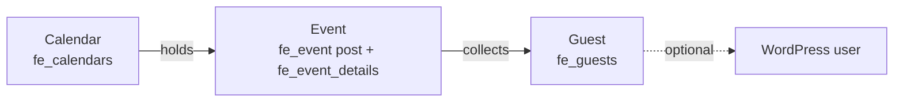

## The Data Model

Three records carry the whole plugin:



- **Calendar.** A container for events, with a status (`public`, `private`, `draft`) and a colour. An event in a non-public calendar never appears on a public page.
- **Event.** A `fe_event` post (title, slug, description, author) plus one `fe_event_details` row (dates in UTC, time zone, venue type, calendar, `meta`). Its status is `public`, `unlisted`, `private` or `draft`.
- **Guest.** One person on one event. There is no separate registrations table: the guest row is the registration. A guest is a name and an email, with an optional link to a WordPress user.

How people join an event depends on `event_details.meta.entry_type`:

| Entry type | Who registers | How |
| --- | --- | --- |
| `rsvp` | Logged-in members in the portal; anyone on the public page | Going / not going. On the public page, Going only, by name and email. |
| `open` | Anyone | A Register button with name and email. A member can say not going and register again in the portal; a visitor's registration is final. |
| `none` | Nobody | View only. Every viewer sees the whole event, meeting link included. Admins can still add guests. |

An `rsvp` or `open` event can set `meta.capacity`, the most guests going at once (`0` = no limit). A full event refuses a new Going or Register. Guests answer only going or not going; only an admin sets `cancelled`.

See [Database Schema](/database/schema) for every column.

## Where Things Live

| Concern | Source |
| --- | --- |
| Plugin bootstrap | `fluent-event.php`, `boot/app.php` |
| REST routes | `app/Http/Routes/api.php` |
| Permissions | `app/Http/Policies/` |
| Controllers | `app/Http/Controllers/` |
| Validation and sanitizing | `app/Http/Requests/` |
| Business logic shared by several callers | `app/Services/` |
| Models | `app/Models/` |
| Migrations | `database/Migrations/` |
| Hook registrations | `app/Hooks/actions.php`, `app/Hooks/Handlers/` |
| Public pages, shortcodes, blocks | `app/Hooks/Handlers/FrontEndHandler.php`, `BlockEditorHandler.php` |
| FluentCommunity integration | `Modules/FluentCommunity/` |
| Admin app (Vue 3) | `resources/admin/` |

## How a Request Flows

1. WordPress matches a route under `fluent-event/v2` and calls the route's **policy**. Admin routes need `manage_options`.
2. The **controller** sanitizes the input with the request class, validates it, and does the write. A write with one caller stays in the controller; logic with several callers lives in a **service**.
3. The controller fires the `fluent_event/...` **hooks** and returns the payload array.
4. Slow work (emails, reminder batches) is queued in **Action Scheduler**, group `fluent-event`.

## Extending FluentEvent

Start your add-on on [`fluent_event/loaded`](/hooks/actions/system#fluent-event-loaded), which fires once the plugin has booted:

```php
add_action('fluent_event/loaded', function () {
    add_action('fluent_event/guest/created', function ($guest) {
        // A guest registered or was added.
    });

    add_filter('fluent_event/event_api_response', function ($data, $event) {
        $data['my_field'] = get_post_meta($event->post_id, '_my_field', true);
        return $data;
    }, 10, 2);
});
```

- [Action hooks](/hooks/actions/) and [filter hooks](/hooks/filters/) list every hook with its arguments and call sites.
- The [REST API](/restapi/) reference has a playground for every endpoint.
- [Guides](/guides/) cover the public pages, shortcodes and blocks, emails and the FluentCommunity integration.

## Building These Docs

The pages under Database, Hooks and REST API are generated from the plugin source. To rebuild them after a code change:

```bash
cd dev-docs-repo
yarn install
yarn docs:dev      # regenerate, then start the dev server
yarn docs:build    # regenerate, then build the static site
```
