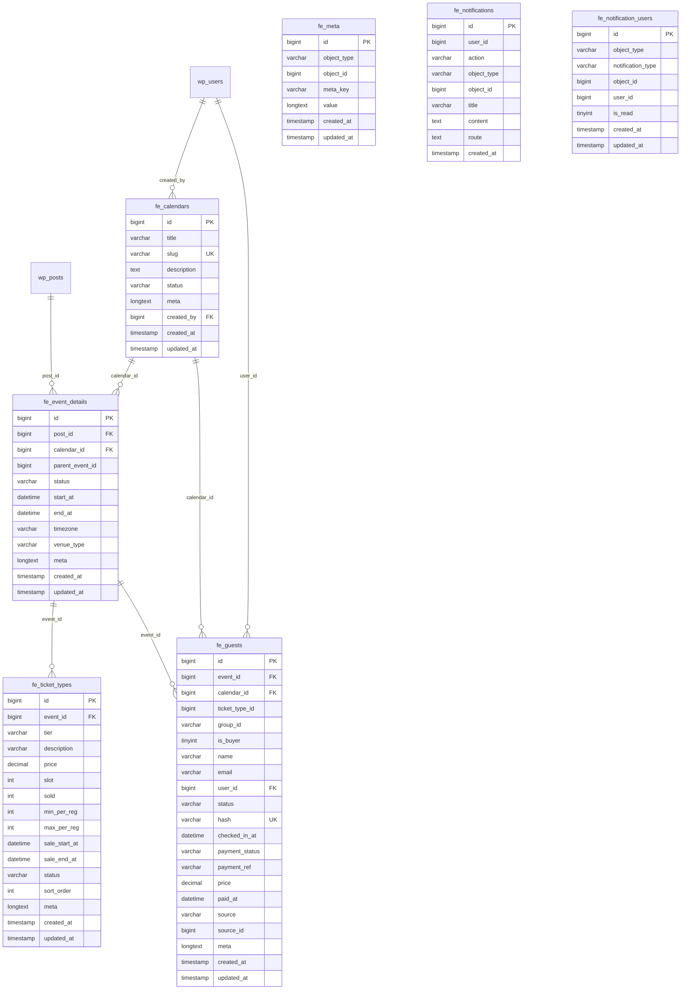

# Database Schema

FluentEvent creates 7 tables, all prefixed `{$wpdb->prefix}fe_`. Each table has its own migrator in `database/Migrations/`, and `DBMigrator` runs them on activation and on upgrade. The current schema version is `1.0.1` (`FLUENT_EVENT_DB_VERSION`).

An event is a **custom post type hybrid**. The `fe_event` post in `wp_posts` holds the title, slug, description, status and author. The `fe_event_details` row holds everything typed: dates, calendar, venue and the `meta` JSON. The two rows are 1:1 on `post_id` and are always written in one transaction.

::: tip Three things people get wrong
- **There is no registrations table.** A guest row *is* the registration. An order is the set of guest rows that share a `group_id`; the `is_buyer = 1` row carries the payment fields.
- **No inheritance between events.** `parent_event_id` is reserved for recurrence, but every row owns its own post and its own full values.
- **Images are URLs.** A cover image is `event_details.meta.cover_url`, never an attachment ID or an image column.
:::

## Table Inventory

| Table | Model | Purpose | Migration |
| --- | --- | --- | --- |
| `fe_calendars` | [`Calendar`](/database/models/calendar) | Calendars. Every event belongs to exactly one. | `database/Migrations/CalendarsMigrator.php` |
| `fe_event_details` | [`Event`](/database/models/event) | The typed half of an event: dates, calendar, venue type and the `meta` JSON. 1:1 with its `fe_event` post. | `database/Migrations/EventDetailsMigrator.php` |
| `fe_ticket_types` | — | Reserved for the future `ticketed` entry mode. No code reads or writes it yet. | `database/Migrations/TicketTypesMigrator.php` |
| `fe_guests` | [`Guest`](/database/models/guest) | One row per person per event. A guest row is the registration; there is no separate registrations table. | `database/Migrations/GuestsMigrator.php` |
| `fe_meta` | [`Meta`](/database/models/meta) | Key-value storage for settings and per-event bookkeeping, scoped by `object_type`. | `database/Migrations/MetaMigrator.php` |
| `fe_notifications` | — | Reserved for in-app notifications. No code reads or writes it yet. | `database/Migrations/NotificationsMigrator.php` |
| `fe_notification_users` | — | Reserved for per-user notification delivery and preferences. No code reads or writes it yet. | `database/Migrations/NotificationUsersMigrator.php` |
| `wp_posts` | [`Post`](/database/models/post) | Holds the `fe_event` post: title, slug, description (HTML), status and author. | WordPress core |
| `wp_users` | [`User`](/database/models/user) | WordPress users. Hosts and logged-in guests link here through `user_id`. | WordPress core |
| `wp_options` | — | The general settings, under the option key `fe_settings`. | WordPress core |

## Relationships

The diagram is built from the column comments in the migrations, so it shows the links the schema declares. There are no database-level foreign keys: WordPress tables are often MyISAM, and the plugin removes child rows in PHP (see [Cleanup](/database/models#cleanup-on-delete)).

## `fe_calendars`

Calendars. Every event belongs to exactly one.

Model: [`Calendar`](/database/models/calendar) · Source: `fluent-event/database/Migrations/CalendarsMigrator.php`

| Column | Type | Nullable | Default | Notes |
| --- | --- | --- | --- | --- |
| `id` | `bigint(20) unsigned` | No | — | Primary key, auto increment |
| `title` | `varchar(255)` | No | — |  |
| `slug` | `varchar(191)` | No | — |  |
| `description` | `text` | Yes | — | optional, no UI or endpoint sets it |
| `status` | `varchar(64)` | No | `public` | public \| private \| draft |
| `meta` | `longtext` | Yes | — | logo_url, cover_url, managers, preferences |
| `created_by` | `bigint(20) unsigned` | No | — | wp_users.ID of the creator |
| `created_at` | `timestamp` | Yes | — |  |
| `updated_at` | `timestamp` | Yes | — |  |

**Indexes**

| Name | Columns | Unique |
| --- | --- | --- |
| `PRIMARY` | `id` | Yes |
| `uq_calendars_slug` | `slug` | Yes |

## `fe_event_details`

The typed half of an event: dates, calendar, venue type and the `meta` JSON. 1:1 with its `fe_event` post.

`status` is `public`, `unlisted`, `private` or `draft`, and the post's `post_status` follows it on every write (`public` and `unlisted` → `publish`, `private` → `private`, `draft` → `draft`). `start_at` and `end_at` are stored in **UTC**; `timezone` is the organizer's zone, used to show local times.

Model: [`Event`](/database/models/event) · Source: `fluent-event/database/Migrations/EventDetailsMigrator.php`

| Column | Type | Nullable | Default | Notes |
| --- | --- | --- | --- | --- |
| `id` | `bigint(20) unsigned` | No | — | Primary key, auto increment |
| `post_id` | `bigint(20) unsigned` | No | — | wp_posts.ID of the fe_event post |
| `calendar_id` | `bigint(20) unsigned` | No | — | fe_calendars.id |
| `parent_event_id` | `bigint(20) unsigned` | Yes | — | recurrence parent |
| `status` | `varchar(64)` | No | `public` | public \| unlisted \| private \| draft |
| `start_at` | `datetime` | No | — |  |
| `end_at` | `datetime` | No | — |  |
| `timezone` | `varchar(64)` | Yes | — | organizer local time, for display |
| `venue_type` | `varchar(64)` | Yes | `offline` | offline \| online \| hybrid |
| `meta` | `longtext` | Yes | — | cover_url, online_meeting_url, address, form_fields, entry_type |
| `created_at` | `timestamp` | Yes | — |  |
| `updated_at` | `timestamp` | Yes | — |  |

**Indexes**

| Name | Columns | Unique |
| --- | --- | --- |
| `PRIMARY` | `id` | Yes |
| `uq_events_post` | `post_id` | Yes |
| `idx_event_window` | `start_at`, `end_at` | No |
| `idx_event_parent` | `parent_event_id`, `start_at` | No |
| `idx_events_calendar_startat` | `calendar_id`, `start_at` | No |

## `fe_ticket_types`

Reserved for the future `ticketed` entry mode. No code reads or writes it yet.

Source: `fluent-event/database/Migrations/TicketTypesMigrator.php`

| Column | Type | Nullable | Default | Notes |
| --- | --- | --- | --- | --- |
| `id` | `bigint(20) unsigned` | No | — | Primary key, auto increment |
| `event_id` | `bigint(20) unsigned` | No | — | fe_event_details.id |
| `tier` | `varchar(128)` | No | — | display name, e.g. VIP, General |
| `description` | `varchar(255)` | Yes | — | additional information related to the tier |
| `price` | `decimal(10,2)` | No | `0.00` |  |
| `slot` | `int` | Yes | — | NULL = unlimited |
| `sold` | `int` | No | `0` |  |
| `min_per_reg` | `int` | No | `1` |  |
| `max_per_reg` | `int` | Yes | — | NULL = unlimited |
| `sale_start_at` | `datetime` | Yes | — |  |
| `sale_end_at` | `datetime` | Yes | — |  |
| `status` | `varchar(64)` | No | `active` | active \| inactive |
| `sort_order` | `int` | No | `0` |  |
| `meta` | `longtext` | Yes | — |  |
| `created_at` | `timestamp` | Yes | — |  |
| `updated_at` | `timestamp` | Yes | — |  |

**Indexes**

| Name | Columns | Unique |
| --- | --- | --- |
| `PRIMARY` | `id` | Yes |
| `idx_ticket_types_event` | `event_id` | No |

## `fe_guests`

One row per person per event. A guest row is the registration; there is no separate registrations table.

`email` and `user_id` are each unique per event, so one person cannot hold two rows on one event. `group_id` ties the rows of one order together and `is_buyer = 1` marks the row that carries the order; with RSVP and open registration every row is its own order. The payment columns (`payment_status`, `payment_ref`, `price`, `paid_at`) and `ticket_type_id` are reserved for ticketing and stay `NULL` today.

Model: [`Guest`](/database/models/guest) · Source: `fluent-event/database/Migrations/GuestsMigrator.php`

| Column | Type | Nullable | Default | Notes |
| --- | --- | --- | --- | --- |
| `id` | `bigint(20) unsigned` | No | — | Primary key, auto increment |
| `event_id` | `bigint(20) unsigned` | No | — | fe_event_details.id |
| `calendar_id` | `bigint(20) unsigned` | No | — | fe_calendars.id, denormalised |
| `ticket_type_id` | `bigint(20) unsigned` | Yes | — | NULL for RSVP, required when ticketed |
| `group_id` | `varchar(64)` | No | — | rows sharing this value are one order |
| `is_buyer` | `tinyint(1)` | No | `0` | one per group_id, carries order and payment |
| `name` | `varchar(255)` | Yes | — |  |
| `email` | `varchar(191)` | Yes | — |  |
| `user_id` | `bigint(20) unsigned` | Yes | — | wp_users.ID when logged in |
| `status` | `varchar(64)` | No | — | going \| not_going \| checked_in \| cancelled |
| `hash` | `varchar(64)` | Yes | — | per-ticket token, wp_generate_password |
| `checked_in_at` | `datetime` | Yes | — |  |
| `payment_status` | `varchar(64)` | Yes | — | paid \| unpaid \| refunded |
| `payment_ref` | `varchar(255)` | Yes | — |  |
| `price` | `decimal(10,2)` | Yes | — |  |
| `paid_at` | `datetime` | Yes | — |  |
| `source` | `varchar(64)` | Yes | — | manual \| wordpress_pages \| fluent_community |
| `source_id` | `bigint(20) unsigned` | Yes | — | id in the originating system, scoped by source |
| `meta` | `longtext` | Yes | — | form_response and other per-guest data |
| `created_at` | `timestamp` | Yes | — |  |
| `updated_at` | `timestamp` | Yes | — |  |

**Indexes**

| Name | Columns | Unique |
| --- | --- | --- |
| `PRIMARY` | `id` | Yes |
| `uq_guests_hash` | `hash` | Yes |
| `uq_guest_event_email` | `event_id`, `email` | Yes |
| `uq_guest_event_user` | `event_id`, `user_id` | Yes |
| `idx_guest_event_status` | `event_id`, `status` | No |
| `idx_guest_calendar` | `calendar_id`, `status` | No |
| `idx_guest_order` | `group_id` | No |
| `idx_guest_email` | `email` | No |
| `idx_guests_ticket_type` | `ticket_type_id` | No |
| `idx_guest_created` | `created_at` | No |

## `fe_meta`

Key-value storage for settings and per-event bookkeeping, scoped by `object_type`.

Rows in use today:

| `object_type` | `object_id` | `meta_key` | `value` |
| --- | --- | --- | --- |
| `option` | `NULL` | `email` | Email sender settings (JSON) |
| `option` | `NULL` | `email_notifications` | Email notification settings (JSON) |
| `event` | event ID | `reminder_email:<seconds>` | One reminder send: `{"status": "scheduled\|completed\|skipped", "cursor": <last guest ID>}` |
| `event` | event ID | `fcom_feed_id` | The FluentCommunity post that shows the event |

Model: [`Meta`](/database/models/meta) · Source: `fluent-event/database/Migrations/MetaMigrator.php`

| Column | Type | Nullable | Default | Notes |
| --- | --- | --- | --- | --- |
| `id` | `bigint(20) unsigned` | No | — | Primary key, auto increment |
| `object_type` | `varchar(50)` | No | — | option \| user \| calendar \| event |
| `object_id` | `bigint(20) unsigned` | Yes | — |  |
| `meta_key` | `varchar(191)` | No | — |  |
| `value` | `longtext` | Yes | — |  |
| `created_at` | `timestamp` | Yes | — |  |
| `updated_at` | `timestamp` | Yes | — |  |

**Indexes**

| Name | Columns | Unique |
| --- | --- | --- |
| `PRIMARY` | `id` | Yes |
| `idx_meta_lookup` | `object_type`, `object_id`, `meta_key` | No |
| `idx_meta_object_key` | `object_id`, `meta_key` | No |

## `fe_notifications`

Reserved for in-app notifications. No code reads or writes it yet.

Source: `fluent-event/database/Migrations/NotificationsMigrator.php`

| Column | Type | Nullable | Default | Notes |
| --- | --- | --- | --- | --- |
| `id` | `bigint(20) unsigned` | No | — | Primary key, auto increment |
| `user_id` | `bigint(20) unsigned` | Yes | — | actor who caused it |
| `action` | `varchar(128)` | No | — |  |
| `object_type` | `varchar(64)` | Yes | — |  |
| `object_id` | `bigint(20) unsigned` | Yes | — |  |
| `title` | `varchar(255)` | Yes | — |  |
| `content` | `text` | Yes | — |  |
| `route` | `text` | Yes | — |  |
| `created_at` | `timestamp` | Yes | — |  |

**Indexes**

| Name | Columns | Unique |
| --- | --- | --- |
| `PRIMARY` | `id` | Yes |

## `fe_notification_users`

Reserved for per-user notification delivery and preferences. No code reads or writes it yet.

Source: `fluent-event/database/Migrations/NotificationUsersMigrator.php`

| Column | Type | Nullable | Default | Notes |
| --- | --- | --- | --- | --- |
| `id` | `bigint(20) unsigned` | No | — | Primary key, auto increment |
| `object_type` | `varchar(64)` | No | — | notification \| notification_pref |
| `notification_type` | `varchar(128)` | No | — |  |
| `object_id` | `bigint(20) unsigned` | No | — |  |
| `user_id` | `bigint(20) unsigned` | No | — |  |
| `is_read` | `tinyint(1)` | No | `0` |  |
| `created_at` | `timestamp` | Yes | — |  |
| `updated_at` | `timestamp` | Yes | — |  |

**Indexes**

| Name | Columns | Unique |
| --- | --- | --- |
| `PRIMARY` | `id` | Yes |
| `uq_notif_user` | `user_id`, `object_type`, `object_id`, `notification_type` | Yes |
| `idx_notif_user_inbox` | `user_id`, `is_read`, `object_type` | No |
| `idx_notif_user_object` | `object_id`, `is_read`, `object_type`, `notification_type` | No |
