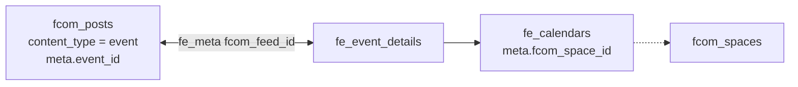

# FluentCommunity Integration

With FluentCommunity active, FluentEvent can run inside the community portal: events are posted in discussion spaces, members RSVP from the feed, and the portal gets an **Events** section.

## Turning It On

The integration starts only when an administrator turns on **FluentEvent** in **FluentCommunity → Settings → Features**. FluentCommunity then fires `fluent_community/fluent_event/init`, and FluentEvent registers its portal, feed and space handlers (`Modules/FluentCommunity/Bootstrap.php`). With the feature off, FluentEvent runs standalone and the [Community Portal API](/restapi/community) refuses every request.

The portal section lives under a base slug set in FluentCommunity's FluentEvent settings (default `events`).

## Events Are Posts

An event in the portal is an ordinary FluentCommunity post with `content_type = 'event'` and the event ID in `meta.event_id`. FluentCommunity owns the post; FluentEvent keeps the event in step through FluentCommunity's hooks.

The link is kept in both directions: `meta.event_id` on the post, and an `fe_meta` row (`object_type = event`, `meta_key = fcom_feed_id`) on the event.

| In the portal | What FluentEvent does |
| --- | --- |
| An admin posts an event in a space | Validates the event fields, creates the event in the space's calendar, links both ways, fires `fluent_event/event/created`. If anything fails, the post is deleted too. |
| An admin posts an event outside any space | Same, in the shared **Community** calendar. Needs FluentCommunity's global posts setting on. |
| The post is edited | Keeps `content_type` and `meta.event_id` on the post, whatever else changes. |
| The post moves to another space | Moves the event (and its guests) to that space's calendar, fires `fluent_event/event/updated`. |
| The post is deleted | The event becomes a **draft** and keeps its guests. An admin decides whether to delete it. |
| The space is deleted | Its calendar becomes a draft and loses its space link; every event in it becomes a draft. |

Only users with `manage_options` can post events, and only in **discussion** spaces (`type = community`), not in course spaces.

## One Calendar per Space

The first event posted in a space creates that space's calendar (`meta.fcom_space_id`), titled after the space and fired through `fluent_event/calendar/created`. Events posted outside any space go to one shared calendar (`meta.fcom_global = true`). Space calendars start `private`, so their events stay off the public WordPress pages.

Moving an event to another calendar in the admin moves its post too:

- to a space calendar → the post moves to that space (its topics are dropped, since topics belong to a space);
- to the Community calendar → the post moves out of any space;
- to a calendar with no space → the post lets go of the event and stays as a plain post.

## Who Sees What

Visibility follows the post. A member sees an event when they can see its post: the post is published, its author's profile is active, and the member can see the space (or the portal feed, for an event outside any space). Draft events never appear.

| Entry type | Logged-in member | Visitor (portal open to visitors) |
| --- | --- | --- |
| `rsvp` | Going / not going, and can change it | Sees the event; cannot RSVP |
| `open` | Register (name prefilled, email locked), can say not going and register again | Register by name and email; final |
| `none` | View only, meeting link included | View only |

The meeting link of an online event shows only to guests who hold a seat (`going` or `checked_in`), except on `none` events.

## Portal Routes

FluentEvent adds these portal routes. Filter them with [`fluent_event/community/route_paths`](/hooks/filters/community#fluent-event-community-route-paths):

| Key | Default path |
| --- | --- |
| `events` | `events` |
| `create_event` | `events/create` |
| `edit_event` | `events/:event_slug/edit` |
| `event_view` | `events/:event_slug` |
| `space_events` | `events` (inside a space) |
| `space_event_view` | `events/:event_slug` (inside a space) |

It also adds an **Events** item to the main and mobile menus, and an **Events** tab to each discussion space header.

## Hooks Worth Knowing

- [`fluent_event/event/calendar_changed`](/hooks/actions/events#fluent-event-event-calendar-changed): the bridge moves the post here.
- [`fluent_event/event/before_deleted`](/hooks/actions/events#fluent-event-event-before-deleted): the bridge unlinks the post at priority 5, before the cleanup at 10.
- [`fluent_event/events_api_response`](/hooks/filters/events#fluent-event-events-api-response) and [`fluent_event/event_api_response`](/hooks/filters/events#fluent-event-event-api-response): the bridge adds `feed_url`.
- [`fluent_event/calendars_api_response`](/hooks/filters/calendars#fluent-event-calendars-api-response): the bridge adds `space_url`.
